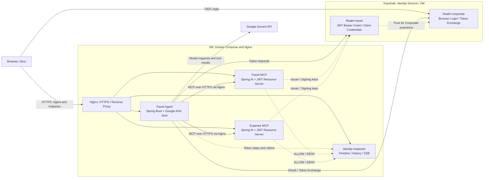

# Who are you Agent?

This repository contains the demos for the talk **“Who are you Agent?”**.
An AI agent organizes a business trip and handles travel expenses. The demos
make it visible which identity it uses to access business systems and which
permissions those systems actually enforce.

The central question is: **Does the agent act with its own broadly privileged
service identity, or with restricted permissions delegated by the signed-in
user?** The same business request can therefore lead to different authorization
decisions.

## Idea and Goals of the Demos

A language model can suggest a tool call. Whether that call is allowed,
however, is decided by the business systems based on validated access tokens.
The demos therefore connect a real Gemini agent to two protected MCP servers
and a UI that makes token steps and access decisions visible.

Two implemented operating modes are compared:

| Mode | Identity used for MCP access | What the demo demonstrates |
|---|---|---|
| **Overprivileged** | Service account with broad scopes | The agent can approve an expense even though that permission is not derived from the identity of the signed-in human. |
| **Delegated** | User-related tokens from an OAuth chain across two Keycloak realms | The agent may search, book, and create/read expenses; approval fails without `expenses.approve`. |

In **both** modes, the MCP servers check the JWT signature, issuer, audience,
validity, and required tool scopes. Here, Overprivileged means an overly
powerful service-account token; the servers do not disable authorization
checks when the mode changes.

A third mode, **Google Agent Identity**, is planned as an extension.
It is present in the UI but explicitly refuses execution until a real,
verified agent-identity integration has been implemented. Illustrative
Inspector data is not evidence of such an integration.

## Use Case: Business Travel and Expenses

Alice wants to travel from Stuttgart (`STR`) to Berlin (`BER`). The agent can
search for demo flights, book a flight, and create a related expense.
Approving an expense requires a separate permission.

| Business system | MCP tool | Required scope |
|---|---|---|
| Travel | `search_flights(origin, destination, date)` | `travel.read` |
| Travel | `book_flight(flightId, traveler, date)` | `travel.book` |
| Travel | `get_booking(bookingId)` | `travel.read` |
| Expense | `create_expense(bookingId, amount)` | `expenses.create` |
| Expense | `get_expense(expenseId)` | `expenses.read` |
| Expense | `approve_expense(expenseId)` | `expenses.approve` |

The business systems use deterministic demo data and store changes in memory.
No real trips are booked or payments initiated. Gemini calls, however, are
real API calls and require a valid API key and a project/model enabled for
that purpose.

For the permission comparison, there is a pre-seeded expense,
**`EXP-8000` for EUR 8,000**, initially in status `PENDING`. It is independent
of a newly booked trip. Among other flights, Travel returns `FL-100` for
EUR 149. Booking IDs and newly created expense IDs are assigned during calls;
use the IDs actually returned for subsequent calls.

## Architecture

The VM deployment contains four application containers behind an Nginx reverse
proxy. Keycloak is an identity service with two realms that must be provisioned
separately. Gemini is accessed as an external API. Keycloak and Nginx are not
part of the four application services in the Compose files.



### Components and Endpoints

The hostnames are the project's example configuration and can be customized.
The listed host ports are bound only to loopback in Compose.

| Component | Responsibility | Example access / Host port |
|---|---|---|
| Travel Agent | Browser BFF, OIDC login, token acquisition, Gemini and MCP orchestration | `https://agent.agile-dev.de`, `127.0.0.1:18085` |
| Travel MCP | Flight and booking functions with server-side scope checks | `https://travel.agile-dev.de/mcp`, `127.0.0.1:18081` |
| Expense MCP | Expenses and approvals with server-side scope checks | `https://expense.agile-dev.de/mcp`, `127.0.0.1:18082` |
| Identity Inspector | Display of sanitized events through history and Server-Sent Events | SSH tunnel or protected proxy to `127.0.0.1:18090` |
| Keycloak | Realms `corporate` and `travel`, clients, grants, scopes, and audience mappers | `https://keycloak.agile-dev.de` |
| Gemini | Language model for selecting and executing tools through the agent | External Google API |

The agent and both MCP servers send events within the Compose network to
`http://inspector:8090/api/events`. They share an `INSPECTOR_API_KEY` for this
purpose. The Inspector receives these events; it does not make access decisions
or validate JWTs. Enforcement remains with the MCP servers.

### Identities and Token Flows

Browser login in the Corporate realm is required in both modes.
The identity subsequently used to access the business systems differs:

**Overprivileged:** The agent requests a service-account token in the Travel
realm using Client Credentials. This token contains both MCP audiences and all
five demo scopes, including `expenses.approve`. There are separate token caches
for the two resources; the Client Credentials request does not request
resource-specific scopes.

**Delegated:** The agent uses the signed-in user's Corporate access token
(Token 1), exchanges it in the Corporate realm for an assertion targeting the
destination domain (Token 2), and redeems it through the JWT Bearer Grant in
the Travel realm for an MCP access token (Token 3). This happens separately
for Travel and Expense. Keycloak must provide the cross-realm trust
relationship and the respective grant permissions.

| Token | Audience must contain | Required scopes |
|---|---|---|
| Delegated Travel | `travel-mcp` | `travel.read travel.book` |
| Delegated Expense | `expense-mcp` | `expenses.create expenses.read`, **no** `expenses.approve` |
| Overprivileged | `travel-mcp` and `expense-mcp` | `travel.read travel.book expenses.create expenses.read expenses.approve` |

The combination of Token Exchange and JWT Bearer Grant follows the
[OAuth Identity and Authorization Chaining Across Domains](https://www.keycloak.org/securing-apps/oauth-identity-authorization-chaining-across-domains)
approach described by Keycloak. The overall chaining approach is a draft;
the grants used are described in RFC 8693 and RFC 7523.

## Project Structure and Technology

| Directory | Contents / Documentation |
|---|---|
| [`travel-agent/`](travel-agent/README.md) | Spring Boot BFF, Google ADK for Java, Gemini, token provider, request-local MCP clients |
| [`travel-domain/`](travel-domain/README.md) | Travel MCP server and simulated bookings |
| [`expense-domain/`](expense-domain/README.md) | Expense MCP server and simulated expenses |
| [`identity-inspector/`](identity-inspector/README.md) | Inspector API, in-memory history, and HTML/JavaScript UI |
| [`deploy/`](deploy/README.md) | VM deployment, Compose, Nginx, audience mappers, detailed demo tests |
| [`scripts/`](scripts/README.md) | Helper scripts, including automated Keycloak scope configuration |

The applications use Java 25, Maven, Spring Boot **4.1.2**, and Spring Security.
The MCP servers use Spring AI **2.0.1** and Streamable HTTP. The agent uses
Google ADK for Java; version **1.14.0** is configured in the current project.
Complete dependency versions are listed in the respective `pom.xml` files.

## Deployment and Configuration

### Prerequisites

- VM with Docker Engine and Docker Compose; public HTTPS endpoints additionally
  require Nginx, DNS records, and suitable TLS certificates.
- Reachable Keycloak with the `corporate` and `travel` realms, the three agent
  clients, and the required grant/trust settings.
- Gemini API key and a model available to the project that supports
  `generateContent`. The combination confirmed in the demo environment is
  ADK 1.14.0 with **`gemini-3.1-flash-lite`**.
- JDK 25 and Maven for local Java builds; Python 3 without additional packages
  for Keycloak automation.

### Starting the Application Containers

From the repository directory:

```bash
cp deploy/.env.example deploy/.env
# Fill deploy/.env with the actual values before starting.
```

Check at least the following settings:

| Variables | Purpose |
|---|---|
| `GOOGLE_API_KEY`, `GEMINI_MODEL` | Gemini access; explicitly set `GEMINI_MODEL=gemini-3.1-flash-lite` for the confirmed demo configuration |
| `CORPORATE_ISSUER`, `TRAVEL_ISSUER` | Reachable realm issuers; must match the issued tokens |
| `CORPORATE_CLIENT_ID` / `CORPORATE_CLIENT_SECRET` | Browser login and Corporate Token Exchange |
| `TRAVEL_GRANT_CLIENT_ID` / `TRAVEL_GRANT_CLIENT_SECRET` | Delegated JWT Bearer Grant in the Travel realm |
| `INSECURE_CLIENT_ID` / `INSECURE_CLIENT_SECRET` | Overprivileged service account; the historical variable name does not disable any server checks |
| `TRAVEL_MCP_URL`, `EXPENSE_MCP_URL` | MCP endpoints reachable from the agent container |
| `TRAVEL_AUDIENCE`, `EXPENSE_AUDIENCE` | Expected audience values; the claims must be issued through Keycloak mappers |
| `TRAVEL_SCOPES`, `EXPENSE_SCOPES`, `EXCHANGE_SCOPE`, `EXCHANGE_AUDIENCE` | Requested scopes and target of the Corporate exchange; align exactly with Keycloak |
| `INSPECTOR_API_KEY` | Shared key for all event senders and the Inspector |
| `SESSION_COOKIE_SECURE` | Set to `true` for public HTTPS use |
| `INSPECTOR_DEMO_ENABLED` | Can remain `false` for real agent events |

Do not commit real secrets to Git. Do not put Keycloak admin credentials in
the Compose `.env`, because that file is loaded into the agent container.
Review example and default values before use, particularly the model name
and exchange scope.

```bash
cd deploy
docker compose --env-file .env -f docker-compose.yaml config --quiet
docker compose --env-file .env -f docker-compose.yaml up -d
docker compose -f docker-compose.yaml ps
```

The four published images are `andifalk/travel-agent`,
`andifalk/travel-domain`, `andifalk/expense-domain`, and
`andifalk/identity-inspector`. **In the current repository, both
`docker-compose.yaml` and `compose-local.yaml` use published images.**
Local builds are available through the modules' `Dockerfile` files and the
`deploy/build-*.sh` scripts; the build scripts support `PUSH=false` when
only a local build is needed.

After changing `.env`, recreate the affected containers with
`docker compose up -d`. After changing Java/UI code, first build and publish
or locally load the corresponding images, then update the containers.

### Keycloak and Audience Mappers

The browser registration currently requests `openid profile email access-travel`.
The exchange request separately uses `EXCHANGE_SCOPE`; its template/fallback
value is `access-travel-domain`. Configure Keycloak for the actual values.
Changing `EXCHANGE_SCOPE` does not alter the statically configured login scope
in `travel-agent/src/main/resources/application.yml`.

For example, the Corporate client needs the following valid redirect URI:

```text
https://agent.agile-dev.de/login/oauth2/code/corporate
```

In the Travel realm, an audience mapper on the `travel.read` scope adds the
`travel-mcp` audience, and a mapper on `expenses.read` adds `expense-mcp`.
The four restricted scopes are assigned to the Delegated client as **Optional**
and explicitly requested by the agent. For the Overprivileged client, all five
scopes, including `expenses.approve`, are **Default**, so both audiences are
issued even without a `scope` parameter.

The complete working configuration is documented in the
[deployment guide to audience mappers](deploy/README.md#working-audience-mappers-for-travel-and-expense-mcp).
Mappers and scope assignments can also be configured automatically:

```bash
# From the repository directory; the admin password is entered without echo.
python3 scripts/configure-keycloak.py --admin-user admin --dry-run
python3 scripts/configure-keycloak.py --admin-user admin --apply
```

The script requires existing clients. It configures neither Corporate login
nor cross-realm trust or Token Exchange/JWT Grant permissions. Details on
authentication, scope, and repeatability are provided in the
[automation guide](deploy/README.md#automatically-configure-audience-mappers-and-scope-assignments).

### Nginx and Inspector Access

[`deploy/nginx/`](deploy/nginx/) contains configurations for the agent,
Travel MCP, Expense MCP, and Inspector. Nginx handles TLS and forwards Host
and Forwarded headers to the applications. For the agent, `location /` must
also forward OAuth and API paths. The MCP configurations pass through the
Bearer header; proxy buffering is disabled for SSE.

Access the Inspector either through an SSH tunnel or through the supplied
HTTPS proxy protected by Basic Authentication. Example tunnel:

```bash
ssh -L 8090:127.0.0.1:18090 <user>@<vm>
# Browser: http://localhost:8090
```

The Inspector's read endpoints do not have their own login protection.
The API key in the browser is required only for “Clear” and the simulated
demo buttons. Real events appear automatically through the SSE stream.
Details on DNS, TLS, and enabling the Nginx configurations are provided in
the [deployment README](deploy/README.md).

## Demo Walkthrough

### Preparation

1. Start all four applications and Keycloak; check Gemini access.
2. Open the agent and Inspector side by side. The Inspector should display
   **“Live · SSE connected”**.
3. Sign in to the agent as Alice and select the mode in the agent UI.
   The mode applies per browser session; `GET /api/session` shows the active value.
4. For a reproducible comparison, test Delegated first, then Overprivileged:
   expense `EXP-8000` should still be `PENDING` during the DENY test.

### Business Scenario Introduction

Example requests to the agent, sent individually:

> Use search_flights to search for flights from STR to BER on 2026-12-01.

> Use book_flight to book flight FL-100 for Alice on 2026-12-01, and use
> create_expense to create an expense for EUR 149 with the returned booking ID.
> Do not approve the expense.

The returned IDs and results can be checked using `get_booking` or
`get_expense`. The agent currently has no persistent LLM chat history:
include any required IDs and parameters again in subsequent requests.

### Demo 1: Overprivileged Agent

In **Overprivileged** mode, use the same business system functions with the
service account. Then explicitly request:

> Now explicitly approve expense EXP-8000 using approve_expense.

The Inspector displays **`ALLOW`** for `approve_expense` if the token contains
`expenses.approve`. Then:

> Call get_expense for EXP-8000 and show the status.

After successful execution, the expense is **`APPROVED`**. The demo shows
that the privileges of the service identity determine the agent's capabilities.

### Demo 2: Delegated Agent

In **Delegated** mode, request the same approval for the demo record that
has not yet been approved. Token Exchange and JWT Bearer Grant issue
resource-specific tokens. Reading is allowed, but approval is denied because
the required scope is missing.

| Call | Overprivileged | Delegated |
|---|---|---|
| `search_flights` | `ALLOW` | `ALLOW` |
| `book_flight` / `get_booking` | `ALLOW` | `ALLOW` |
| `create_expense` / `get_expense` | `ALLOW` | `ALLOW` |
| `approve_expense` | **`ALLOW`** | **`DENY`** |
| Status of `EXP-8000` after the approval attempt, initially `PENDING` in each case | `APPROVED` if the business operation succeeds | remains `PENDING` |

The decision is made in the MCP server. `ALLOW` confirms only the permission:
an already approved record can subsequently fail at the business-operation
level with “Already approved”. A chat response alone does not prove a tool
call; the corresponding `TOOL_AUTHORIZATION` event must appear in the Inspector.

### Demo 3: Outlook on Agent Identity

`GOOGLE_AGENT_IDENTITY` is intentionally not executable yet. The goal would
be an additionally verifiable agent identity and its validation at resource
boundaries. The current mode reports an error rather than simulating an
identity check. The Inspector demo buttons generate only illustrative data
and do not replace such evidence.

### What the Inspector Shows

- Token steps such as `TOKEN1_ISSUED`, `TOKEN_EXCHANGED`, and `JWT_GRANT_REDEEMED`.
- `DELEGATED_TOKEN_CLAIMS_TRAVEL` / `DELEGATED_TOKEN_CLAIMS_EXPENSE` and
  `OVERPRIVILEGED_TOKEN_CLAIMS_TRAVEL` / `OVERPRIVILEGED_TOKEN_CLAIMS_EXPENSE`:
  actual `iss`, `aud`, and `scope` values, source `issued`/`cache`, and mode.
- `TOOL_AUTHORIZATION`: tool, `ALLOW`/`DENY`, scope reason, and validated JWT
  identity metadata from the respective MCP server.
- `AGENT_ERROR`: error diagnostics, for example during a token grant or MCP
  tool loading.

A correlation ID connects token and tool events from the same agent request.
The agent's claim diagnostics decode tokens but do not validate their signatures
(`signatureVerified=false`). The MCP servers validate the tokens independently.
Full tokens, client secrets, and tool arguments must not be included in
Inspector events.

The Inspector displays real events without a browser key. Its
“Demo 1 / Demo 2 / Demo 3” buttons, however, generate simulated flows and require
`INSPECTOR_DEMO_ENABLED=true` and the Inspector key. They do not change the mode
of the real agent.

### Repeating the Demos and Troubleshooting

Reset the Expense data on the VM for a new comparison:

```bash
cd deploy
docker compose -f docker-compose.yaml restart expense-mcp
```

This discards all in-memory Expense data and recreates `EXP-8000` with status
`PENDING`. Travel bookings disappear when `travel-mcp` restarts. “Clear” in
the Inspector deletes only the event history. Changing the agent mode clears
its MCP token caches; request new tokens after Keycloak changes.

For diagnostics:

```bash
cd deploy
docker compose -f docker-compose.yaml logs --since=5m travel-agent travel-mcp expense-mcp
curl -sS http://127.0.0.1:18090/api/history
```

| Observation | Where to investigate |
|---|---|
| MCP initialization fails; `aud` contains only `account` | Check audience mappers and their assignment to the issuing client. |
| `approve_expense` returns `ALLOW` in Delegated mode | Check actual scopes; `expenses.approve` must not be present. |
| Overprivileged returns `DENY` | Check default scopes, service-account roles, and actual token claims. |
| Inspector remains empty | Check the shared API key, internal URL, delivery warnings, history, and SSE/Nginx routes. |
| Gemini returns an HTTP error | Check the sanitized Google message in the agent log; verify API access, model availability, and billing. |

Detailed prompts, expected events, and Keycloak prerequisites are provided
in the [test guide](deploy/README.md#test-real-allowdeny-decisions).

## Demo Environment Limitations

Business data, Inspector history, and agent sessions are not designed as a
durable production system. The Inspector keeps the most recent 200 events
in memory. Events are sent asynchronously on a best-effort basis; an Inspector
outage does not change any access decision, and the timeline is not a complete,
durable audit log.

The Overprivileged configuration serves to demonstrate the permission risk.
The demo business systems do not implement complete business ownership or
finance-role checks. Identity and transport configuration, as well as allowed
scopes, must suit the intended use.

## Further References

| Topic | Reference |
|---|---|
| Google ADK | [ADK documentation](https://adk.dev/) and [ADK for Java](https://github.com/google/adk-java) |
| Gemini | [API keys](https://ai.google.dev/gemini-api/docs/api-key), [Models API](https://ai.google.dev/api/models), [Model lifecycles](https://ai.google.dev/gemini-api/docs/deprecations) |
| MCP | [Model Context Protocol – Specification](https://modelcontextprotocol.io/specification/) |
| Spring AI | [MCP support](https://docs.spring.io/spring-ai/reference/api/mcp/mcp-overview.html) |
| Keycloak Chaining | [OAuth Identity and Authorization Chaining Across Domains](https://www.keycloak.org/securing-apps/oauth-identity-authorization-chaining-across-domains) |
| Keycloak configuration | [Server Administration Guide](https://www.keycloak.org/docs/latest/server_admin/) and [Admin REST API](https://www.keycloak.org/docs-api/latest/rest-api/index.html) |
| Token Exchange | [RFC 8693](https://www.rfc-editor.org/rfc/rfc8693.html) |
| JWT Bearer Grant | [RFC 7523](https://www.rfc-editor.org/rfc/rfc7523.html) |
| Browser identity | [OpenID Connect Core](https://openid.net/specs/openid-connect-core-1_0.html) |
